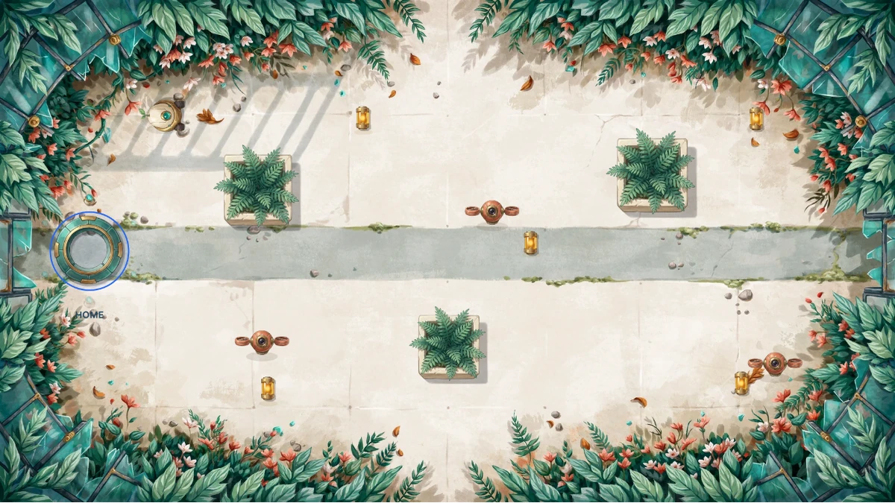

# Relay garden: REA + DreamLayer game assets

A small playable browser game with a reproducible investigation and honest artwork provenance.
Collect six cells, return to the dock, and switch between geometry and artwork without changing the mechanics.

[Play the demo](https://thedesignfounder.github.io/dreamlayer-game-assets/demo/) ·
[Agent workflows](https://github.com/TheDesignFounder/dreamlayer-agent-plugin) ·
[Investigation](docs/rea-workflow.md) · [Verification](docs/verification.md)



## Run locally

Node.js 22.19+ on the 22.x line (or another REA-supported version) is required for the pinned REA package. Playing the bundled demo only needs a static web server.

```sh
git clone https://github.com/TheDesignFounder/dreamlayer-game-assets.git
cd dreamlayer-game-assets
npm ci
npm start
```

Open **http://127.0.0.1:4177/demo/**. Use arrow keys, WASD, or the on-screen direction buttons.
Escape pauses. No API key, account, credits, or runtime dependency download is required by the game.

## What happened here

1. We authored a small movement reference and minified it into a separate artifact, without a source map.
2. REA 6.5.0 analyzed that artifact and traced the function containing the `Math.hypot` read to its caller.
3. The coding agent interpreted the bounded movement formula and implemented it independently.
4. We reused real DreamLayer-generated robot frames from the public agent-plugin example. The background,
   obstacles, collectibles, and interface are original SVG/Canvas/CSS artwork, not DreamLayer output.
5. Automated tests compare 2,000 inputs with the artifact. Browser checks play through the game and verify
   that artwork switching preserves state.

This is a **controlled, self-authored demonstration**, not a blind reverse-engineering benchmark or a
recovered commercial game. REA reports partial static coverage. Its caller relation is evidence, not a
runtime proof. [Read the precise boundaries](docs/rea-workflow.md).

## Reproduce the checks

```sh
npm run build:reference
npm run investigate
npm test
npm run validate:assets
npm run art:plan
```

For the browser test, leave `npm start` running in another terminal:

```sh
npx playwright install chromium
npm run test:browser
# Or use an already-installed Google Chrome:
BROWSER_CHANNEL=chrome npm run test:browser
```

`investigate` runs the pinned REA CLI locally. It retains full unmodified Evidence in ignored `.local/`
and writes a sanitized excerpt in `evidence/public/`. Local paths affect Evidence IDs; compare the
target digest and findings rather than assuming IDs are portable.

## Use the agent workflow

The canonical `integrate-game-art` skill lives in the existing DreamLayer plugin repository. Install the
published workflow branch while its pull request is pending:

```sh
npx skills add https://github.com/TheDesignFounder/dreamlayer-agent-plugin/tree/feat/rea-game-assets --skill integrate-game-art --agent codex
```

After that branch is merged, the same selection works with `TheDesignFounder/dreamlayer-agent-plugin`.
Installing instructions does not connect/authenticate either MCP server. Follow the plugin's
[client setup](https://github.com/TheDesignFounder/dreamlayer-agent-plugin/blob/main/docs/client-setup.md).
REA is optional for ordinary artwork tasks. This example used REA's CLI and the connected DreamLayer MCP
for a live capabilities read, not a paid generation.

## Artwork and cost

**New spend: 0 credits.** All seven PNGs are unchanged files from the public DreamLayer sample.
Its historical README reports 1 credit for the reference and 5.8 for the sprite job; those charges were
not incurred or remeasured here. New image generation requires an authenticated account and paid credits.
Read live capabilities and balance before using the canonical generation workflow.

`npm run art:plan` submits nothing and defaults to a zero-credit cap. `-- --live --cap NUMBER` refreshes
capabilities with your installed DreamLayer CLI and evaluates an explicitly supplied cap. It still does
not submit anything. `scripts/resume-art.mjs` only checks/downloads an existing execution.

The optional sample animation has changing eye/body details. It is off by default, and decorative frame
cycling stops under reduced motion. The browser uses the delivered 2,830 ms timing array; the original
ZIP's total-duration metadata says 2,833 ms. [Asset workflow](docs/asset-workflow.md) ·
[Machine-readable manifest](assets/manifest.json).

## Layout and license

- `demo/`: static game, original scene, bundled robot frames.
- `reference/`: controlled source, minified artifact, target digest.
- `scripts/`: local server, investigation, plan/recovery and validation.
- `evidence/public/`: sanitized findings, never private full execution records.

MIT. See [third-party notices](THIRD_PARTY_NOTICES.md). Independent example by DreamLayer; no REA affiliation.
